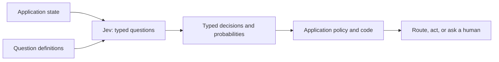

# Jev AI: Typed Decisions for Software Workflows

Jev is TypeSafe AI's first public **System One model**, designed to return typed decisions that application code can use directly. It addresses a different problem from a conversational LLM: instead of generating prose for a person, it evaluates structured questions against application state so software can classify, score, route, or branch.

Jev is not a replacement for every LLM. It is a specialized decision component that can sit beside generative models and ordinary business logic.

## 1. The problem: software needs decisions, not always prose

A support system may need to decide whether a ticket belongs to Billing, whether it is urgent, and whether a human must review it. A chat model can answer in natural language, but the application then has to extract, parse, and validate the decision.

```text
Generative LLM:
state -> generated text -> parse -> validate -> application logic

Jev:
state + typed questions -> typed decisions + probabilities -> application logic
```

The second path makes the contract explicit. The application defines possible answers before inference and owns the actions taken from those answers.

## 2. What Jev is

TypeSafe describes Jev as a **System One model**: a model aimed at fast, structured decisions inside software. Its API takes a state (such as text or JSON) and one or more typed questions. It returns values and probability information rather than free-form generated text.

The model can help with judgments that are hard to express as fixed rules but still have a bounded answer. Code remains responsible for workflow, permissions, business rules, and side effects.



## 3. Core primitives

TypeSafe's documentation describes three question types:

| Primitive | Question shape | Example |
|---|---|---|
| **Choice** | Choose from a defined set of options | Which team should receive this ticket: Billing, Sales, or Technical Support? |
| **Score** | Rate state against a defined rubric | How urgent is this incident on a 1–5 scale? |
| **Noul** | Is a statement true? | Does this message report a duplicate charge? |

Choice and Score can include probabilities and confidence information. Noul returns a value from 0 to 1 for the truth judgment. Consult current TypeSafe documentation for exact response fields and SDK behavior.

Questions can be sent together and evaluated independently against the same state. This works well when each question is narrow and self-contained.

## 4. Design questions that code can own

Ask one well-scoped question at a time. Decompose a broad judgment into dimensions, then combine the results with explicit application logic.

Instead of asking “Should we approve this refund?”, split the decision:

1. Is the request about a duplicate charge?
2. Does the account meet the refund policy's eligibility rules?
3. How confident is the system in each judgment?
4. Does the policy allow automatic approval at those confidence levels?

This separation makes policy visible, testable, and changeable without hiding it inside a prompt.

**Example workflow:**

```text
Ticket text + account context
        |
        v
Choice: category = billing
Noul: duplicate_charge = true
Score: urgency = 4/5
        |
        v
Application checks policy and confidence thresholds
        |
        +--> High confidence, low risk: route automatically
        +--> Uncertain or high impact: request human review
```

The exact thresholds are application policy, not universal model defaults. Choose them using representative data and measured error costs.

## 5. Use Jev with generative models

Jev and generative LLMs can solve complementary parts of a workflow:

```text
LLM: understand or generate language
Jev: make bounded, typed judgments
Application code: enforce policy and perform actions
```

For example, an LLM can draft a helpful customer reply while Jev classifies the case and estimates urgency. The application can route the case, check permissions, and require approval before issuing a refund.

Keep free-form generation where flexible language is the product. Use typed decisions where downstream code needs a bounded result.

## 6. Benefits and trade-offs

### Benefits

- **Direct integration:** Typed answers reduce custom text parsing.
- **Explicit output space:** The application defines possible choices and score rubrics.
- **Uncertainty-aware workflows:** Probabilities or confidence can help drive escalation.
- **Composable decisions:** Small judgments can be combined in normal code.
- **Potential speed and cost gains:** TypeSafe positions Jev for efficient System One workloads; benchmark against your own data, latency targets, and provider costs.

### Trade-offs and limitations

- **Not a text generator:** Jev is not suited to drafting, summarizing, or open-ended conversation.
- **Bounded questions require design:** Poor categories, ambiguous rubrics, or missing options still produce poor decisions.
- **Confidence is not a guarantee:** Calibrated confidence must be checked on the target task and can drift as inputs change.
- **The provider remains a dependency:** Review availability, limits, data handling, compliance, and pricing before production use.
- **Application responsibility remains:** Typed output does not prove that a decision is correct or that an action is authorized.

TypeSafe uses claims such as “zero hallucinations” to describe constrained, typed outputs. That should not be read as “zero semantic errors”: a type-valid category or score can still be wrong. Evaluate decision quality separately from output-format correctness.

## 7. When to use it

Use Jev when:

- The task is a bounded classification, routing, scoring, or truth judgment.
- The result feeds a software branch or workflow.
- Hand-written rules are too brittle, but an open-ended text answer is unnecessary.
- You can define meaningful options or a consistent scoring rubric.
- You can measure false positives, false negatives, and escalation rates.

Prefer a generative LLM when the output must be natural language, the task is open-ended, or a person needs explanation or synthesis. Prefer deterministic code when rules are stable, explicit, and cheap to maintain.

Avoid letting a model directly perform high-impact actions. Put authorization, policy checks, idempotency, audit logging, and human approval in the application layer.

## 8. Evaluation and rollout

1. **Build a representative dataset.** Include common, rare, ambiguous, and adversarial examples.
2. **Define labels and costs.** Record which mistakes matter most; false routing and missed escalation may have different impact.
3. **Establish baselines.** Compare Jev with current rules and a generative-model approach where appropriate.
4. **Measure quality.** Track per-class precision/recall, score agreement, calibration, latency, cost, and human override rate.
5. **Shadow first.** Generate decisions without triggering production actions; compare with human outcomes.
6. **Set risk-based thresholds.** Automate only low-risk cases with validated confidence; send uncertain or high-impact cases to review.
7. **Monitor drift.** Re-evaluate after changes to traffic, policies, data, model, or question definitions.

## 9. Interview questions

### Q1: What problem does Jev solve?
* Answer: Jev targets software workflows that need bounded decisions rather than prose. It returns typed results for application code to consume, avoiding a custom natural-language parsing step.

### Q2: How does Jev differ from a generative LLM?
* Answer: A generative LLM produces flexible text for people or downstream language tasks. Jev evaluates typed questions against state and returns structured decisions. They can be combined in one system.

### Q3: What are Choice, Score, and Noul?
* Answer: Choice selects from defined options, Score evaluates state against a rubric, and Noul estimates whether a statement is true. Exact response fields depend on the current API.

### Q4: How should a broad decision be modeled?
* Answer: Break it into narrow, independent judgments, then combine them in explicit code. Keep business policy and action authorization outside the model.

### Q5: Does typed output mean the decision cannot be wrong?
* Answer: No. A response can be structurally valid but semantically incorrect. Test task accuracy and calibration on representative production-like data.

### Q6: How should confidence be used?
* Answer: Validate calibration on the target task, choose thresholds according to error costs, and escalate uncertain or high-impact cases. Confidence is a signal, not a correctness guarantee.

### Q7: When should a team not use Jev?
* Answer: When it needs free-form generation, when deterministic rules already solve the task well, or when the team cannot define and evaluate a useful decision space.

## References

- [TypeSafe AI: Jev introduction](https://docs.typesafe.ai/introduction)
- [TypeSafe AI: question primitives](https://docs.typesafe.ai/primitives)
- [TypeSafe AI: Introducing System One Models & Jev](https://typesafe.ai/blog/introducing-system-one-models-and-jev)
- [Jev AI là gì? (Viblo)](https://viblo.asia/p/jev-ai-la-gi-mo-hinh-ai-chuyen-dua-ra-quyet-dinh-cua-typesafe-ai-ym400l2j491)
