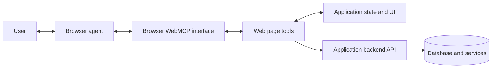

# WebMCP: Exposing Web App Actions to AI Agents

WebMCP is a proposed browser API that lets a web page describe useful actions as named tools with structured inputs. A compatible browser agent can discover those tools and invoke them through the page, instead of guessing how to operate buttons and fields from the DOM.

WebMCP is not a new backend or a replacement for the Model Context Protocol (MCP). It is a browser-facing way for a web application to expose selected frontend capabilities to an agent while the user and application share the same page context.

> **Status:** WebMCP remains a proposed, evolving web standard. As of October 2026, Chrome documentation describes an origin trial starting with Chrome 149 and a local testing flag. Treat APIs and browser availability as experimental; check current documentation before shipping.

## 1. Why WebMCP?

Without structured tools, an agent often has to inspect page content, infer what controls mean, click and type, then interpret the result. Every step can fail because of layout changes, ambiguous labels, or hidden application state.

WebMCP lets the application declare intent directly: for example, `search_products` accepts a query and returns matching products. The agent can use a stable name, description, and JSON Schema rather than reconstructing the action from visual controls.

WebMCP is useful when an agent needs to:

- Search, filter, or compare data already available in a web app.
- Fill in a complex form using values collected from the user.
- Act on current page state, such as a selected account or open support case.
- Keep the interaction visible in the site's existing interface.

It does not remove the need for normal backend APIs, business rules, or authorization. It makes selected application actions discoverable to compatible agents.

## 2. Architecture



The page registers tools with the browser's `document.modelContext`. A compatible agent discovers available tools, chooses one based on the user's request, and asks the browser to execute it. The browser routes the call to the page's JavaScript callback or annotated form. The page can reuse its existing UI logic and call its normal backend API. The result is returned to the agent.

The WebMCP API does not itself define a network connection from an arbitrary remote LLM to the page. A browser, extension, or agent must support WebMCP and have permission to interact with the page. Tool availability is generally scoped to the current browsing context and origin.

### Tool lifecycle

1. **Register:** The page provides a tool name, description, input schema, and implementation.
2. **Discover:** The browser exposes registered tools to a compatible agent.
3. **Select:** The agent chooses a tool and supplies structured arguments.
4. **Execute:** The browser invokes the page's implementation or activates an annotated form.
5. **Return:** The page returns a result, and the agent explains it or continues the workflow.

Descriptions and schemas help agents choose and call tools; they are not a security boundary. The page and backend must validate every request.

## 3. WebMCP APIs

### Imperative API

Use the imperative API for custom behavior, such as searching results, updating application state, or calling an existing API. The example below exposes a read-only product search. It assumes the application has a same-origin `/api/products/search` endpoint.

```js
if ("modelContext" in document) {
  await document.modelContext.registerTool({
    name: "search_products",
    description: "Search the product catalog by keywords. Does not place an order.",
    inputSchema: {
      type: "object",
      properties: {
        query: {
          type: "string",
          description: "Product name or keywords to search for",
        },
      },
      required: ["query"],
      additionalProperties: false,
    },
    annotations: {
      readOnlyHint: true,
    },
    execute: async ({ query }, { signal }) => {
      const response = await fetch(
        `/api/products/search?q=${encodeURIComponent(query)}`,
        { signal },
      );

      if (!response.ok) {
        throw new Error(`Product search failed: ${response.status}`);
      }

      const products = await response.json();
      return JSON.stringify(products);
    },
  });
}
```

The feature check supports graceful degradation in browsers without WebMCP. The page still needs its ordinary UI and API; WebMCP adds an agent-facing route to selected behavior. The server must enforce authorization and validate the query and returned data just as it would for any other request.

`registerTool()` can receive an `AbortSignal` for unregistering a tool when its owning UI component is removed. The tool's `execute` callback can also receive a signal to cancel long-running work. Use these lifecycle features when registering tools from components that mount and unmount.

### Declarative API

Use the declarative API when an existing HTML form already represents the action. Form fields become tool inputs, while `toolname` and `tooldescription` describe the tool.

```html
<form
  toolname="search_help_articles"
  tooldescription="Search help articles using a topic or question."
  action="/help/search"
  method="get"
>
  <label for="topic">Topic or question</label>
  <input id="topic" name="q" type="search" required>
  <button type="submit">Search</button>
</form>
```

The browser can focus the form and populate its fields when an agent invokes the tool. By default, the user can review and submit it. The experimental `toolautosubmit` attribute enables agent-invoked form submission; only use it when the action is safe to execute without a separate confirmation. For consequential actions, keep a clear review and confirmation step.

The declarative API can also use `toolparamdescription` to clarify a field's meaning. For custom validation or agent-specific results, the form's submit handler can detect an agent-invoked submission and return a result using the experimental form event API. Check current browser documentation for exact support and syntax.

### Choosing an API

| Need | Better fit |
|---|---|
| Existing, standard HTML form | Declarative API |
| Custom logic, application state, or API call | Imperative API |
| Browser lacks WebMCP | Keep ordinary UI; agent uses supported fallback, if any |
| Sensitive or irreversible action | Either API, with server enforcement and explicit confirmation |

## 4. How to Build and Use It

1. **Choose narrow actions.** Expose product search or draft creation rather than a generic `run_action` tool.
2. **Write agent-readable metadata.** Give each tool a distinct name and a concise description that explains scope and effects.
3. **Define precise schemas.** Specify required fields, types, enums, and useful descriptions. Reject unexpected or invalid input in the implementation and backend.
4. **Reuse application logic.** Call existing page functions or same-origin APIs instead of duplicating business rules in a tool callback.
5. **Preserve user control.** Keep form actions visible. Ask for confirmation before purchases, account changes, deletion, or other consequential actions.
6. **Test in a compatible browser.** WebMCP is experimental. Follow the current Chrome documentation for its origin trial or local development flag, and use available DevTools or agent extensions to inspect and invoke tools.
7. **Keep fallback behavior.** The website must remain usable without a WebMCP-capable browser or agent.

WebMCP does not make a website globally searchable by agents. The agent generally needs to visit the site, and the browser must expose its tools. It also does not guarantee an agent will call a tool correctly or that it will honor tool annotations.

## 5. WebMCP and Backend MCP Compared

Here, **backend MCP** means a conventional MCP server deployed locally or remotely and connected to an MCP host through an MCP transport. It is a useful contrast, not a separate formal protocol name.

| Dimension | WebMCP | Backend MCP server |
|---|---|---|
| Where tools are defined | In a web page, using browser APIs or annotated forms | In a server process or service implementing MCP |
| How tools are reached | Through a compatible browser agent and the current page | Through an MCP client and configured transport |
| Typical scope | Current site, page, user session, and UI state | Shared data or services available to configured clients |
| Execution location | Page's JavaScript and normal application APIs | MCP server's runtime and connected services |
| Discovery | Tools available to the visited page and authorized browsing context | Tools listed by the connected MCP server |
| Best for | In-page workflows, form completion, and current UI context | Reusable integrations, backend operations, and multiple MCP clients |
| Availability | Depends on browser/agent support; currently experimental | Depends on MCP client and server configuration |

These approaches can complement each other. A page can expose user-visible workflows through WebMCP while a backend MCP server provides reusable service-level tools to other clients. Both need authentication, authorization, validation, and user-consent controls appropriate to the action.

## 6. Security and Design Guidance

- **Treat tool input as untrusted.** Validate types, ranges, ownership, and business rules in the page and again on the server.
- **Do not put secrets in frontend code.** WebMCP callbacks run in the page context and cannot safely hold service credentials.
- **Enforce authorization on every backend request.** A tool schema, hidden button, or browser permission is not authorization.
- **Use explicit confirmation for consequential actions.** An annotation such as `consequentialHint` is a hint to agents and browsers, not a substitute for a real confirmation and server-side safeguards.
- **Handle untrusted results carefully.** User-generated text and external content can contain prompt injection. Delimit or otherwise identify untrusted data before returning it to an agent.
- **Limit cross-origin exposure.** Cross-origin frames are gated by the `tools` Permissions Policy and explicit origin exposure. Grant only required origins.
- **Keep tool purpose narrow.** Avoid tools that allow arbitrary URLs, arbitrary code, or unconstrained actions.
- **Support cancellation and errors.** Pass cancellation signals to long-running operations and return clear, non-sensitive errors.

## 7. When to Use WebMCP

Use WebMCP when a browser agent should act within a website and needs reliable access to page-specific actions or state. It is especially helpful when users should see and control the same workflow.

Do not rely on WebMCP as the only integration path when agents must operate without visiting a page, when a workflow must work across many clients, or when browser support is unavailable. Use ordinary APIs or a backend MCP server for those cases.

### Advantages

- More reliable than inferring every action from the DOM.
- Structured inputs reduce ambiguity and argument errors.
- Reuses existing forms, frontend state, and application APIs.
- Keeps actions in the user's visible browser session.
- Can progressively enhance a site without removing standard UI.

### Trade-offs

- Requires support from both the browser and agent.
- The proposal and APIs can change; production compatibility is not universal.
- Tools are tied to a page visit and browsing context, not automatically discoverable across clients.
- Complex applications may need changes to expose coherent, testable actions.
- Frontend execution does not replace backend security or confirmation.

## 8. Interview Questions

### Q1: What is WebMCP?
* Answer: WebMCP is a proposed browser API for exposing web application actions as named tools with descriptions and structured inputs. Compatible browser agents can discover and invoke those tools in the context of a visited page.

### Q2: Is WebMCP a backend MCP server?
* Answer: No. WebMCP exposes page-level tools through browser APIs and HTML forms. A conventional MCP server runs as a local or remote service and exposes tools to an MCP client over an MCP transport. They solve related integration problems at different layers and can be used together.

### Q3: How does an agent call a WebMCP tool?
* Answer: The page registers an imperative tool or declares an annotated form. A compatible browser makes available tools discoverable, the agent selects one and provides structured arguments, and the browser invokes the page's callback or form. The page returns a result to the agent.

### Q4: When should an application use the declarative API versus the imperative API?
* Answer: Use the declarative API when a standard HTML form already captures the action and its inputs. Use the imperative API for custom JavaScript logic, application state, or API calls that do not map naturally to a form.

### Q5: Does WebMCP make an application secure or authorize an agent?
* Answer: No. Tool metadata and browser access only describe or route actions. The application must validate inputs, authenticate the user, enforce authorization and business rules on the server, and require confirmation for consequential operations.

### Q6: What are WebMCP's main limitations?
* Answer: WebMCP is experimental and requires compatible browser and agent support. An agent generally needs to visit the site to discover its page tools. It is not a replacement for backend APIs or MCP servers used by clients that do not operate through the user's browser.

## References

- [Chrome: WebMCP overview](https://developer.chrome.com/docs/ai/webmcp/)
- [Chrome: Imperative API](https://developer.chrome.com/docs/ai/webmcp/imperative-api/)
- [Chrome: Declarative API](https://developer.chrome.com/docs/ai/webmcp/declarative-api/)
- [Web Machine Learning Community Group: WebMCP draft](https://webmachinelearning.github.io/webmcp/)