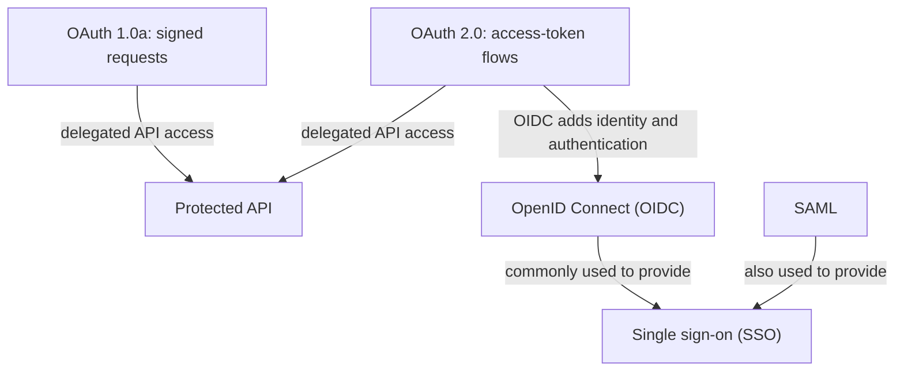

# OAuth 1.0 vs. OAuth 2.0

OAuth lets an application access a user's resources at another service without asking for the user's password. OAuth is an **authorization** framework; it does not, by itself, tell the client who the user is.

> When people say “OAuth 1.0,” they usually mean **OAuth 1.0a**, which fixed an authorization-verification issue in the original 1.0 specification.

## How the versions work

### OAuth 1.0a

1. The client obtains a temporary request token and sends the user to the service to approve access.
2. The service redirects the user back with an authorization verifier.
3. The client exchanges the request token and verifier for an access token.
4. For each API request, the client creates a cryptographic signature using its secret and the token secret. The API checks the signature, timestamp, and nonce.

The signature proves that the request was made by a client holding the secrets. This protects each request, but signing requests correctly is relatively complex.

### OAuth 2.0

A common modern flow is **Authorization Code with PKCE**:

1. The app creates a random verifier and sends its derived challenge when redirecting the user to the authorization server.
2. The user signs in there and approves the requested permissions (scopes).
3. The authorization server redirects back with a short-lived authorization code.
4. The app exchanges the code and verifier for an access token.
5. The app sends the token to the API over HTTPS, and the API checks the token and its permissions.

OAuth 2.0 separates the app, authorization server, and API more flexibly, and PKCE protects the code exchange for public clients such as mobile apps and SPAs. Bearer access tokens are simpler to use, but anyone who steals one may be able to use it until it expires; TLS, short lifetimes, and careful token storage are important.

| | OAuth 1.0a | OAuth 2.0 |
|---|---|---|
| API request | Each request is cryptographically signed | Commonly sends an access token over HTTPS |
| Client setup | Client secret and token secret participate in signatures | Multiple flows for different client types; PKCE is recommended for public clients |
| Main trade-off | Request integrity without relying only on TLS, at the cost of signing complexity | Easier, more flexible integrations; token protection relies heavily on TLS and secure handling |
| Current use | Mostly legacy integrations | Common for modern delegated API access |

OAuth 2.0 is not simply “OAuth 1.0 with a new token format”; it is a different framework with different flows and security responsibilities. Neither version is itself an SSO protocol.

## How OAuth, OIDC, and SSO relate

OAuth 1.0a and OAuth 2.0 are authorization approaches for API access. OIDC builds on OAuth 2.0 when an app also needs a standard way to authenticate the user. SSO is the result users experience; it can be implemented with OIDC or SAML.

## Real-life examples: OAuth, OAuth 2.0, and SSO

### OAuth delegation: a photo-printing app

Suppose **PrintMyPhotos** wants to print selected pictures from a user's photo account. Instead of asking for the user's account password, it sends the user to the photo service. The user signs in there and approves limited access. PrintMyPhotos receives an access token and uses it to read the approved photos. The photo service can revoke that access without changing the user's password.

That is the **OAuth idea**: grant an app limited access to a resource. OAuth 2.0 is a modern way to implement that idea; an older integration could use OAuth 1.0a's signed-request flow.

### OAuth 2.0 in practice

In the example above, a mobile app can use Authorization Code with PKCE: it starts the redirect, the photo service authenticates the user and asks for consent, then returns a code. The app exchanges that code plus its PKCE verifier for an access token and uses the token with the photo API. The photo API receives authorization to access photos; the token alone should not be treated as proof of the user's identity.

### SSO: one sign-in for several work apps

An employee signs in once through the company's identity provider (IdP), then opens the HR portal and internal dashboard without entering credentials again. Each app trusts the IdP and establishes its own session based on the sign-in result.

**Single sign-on (SSO) is the user experience and system capability, not a single protocol.** It is commonly built with OpenID Connect (OIDC) on OAuth 2.0 or with SAML. OAuth 2.0 alone is for delegated authorization; OIDC adds identity information and authentication on top of it.

### Q1: How do OAuth, OAuth 2.0, OIDC, and SSO relate?
* **Answer:** OAuth is a delegated-authorization framework; OAuth 2.0 is its widely used modern version. OIDC adds a standard identity/authentication layer on OAuth 2.0. SSO is the capability of signing in once and accessing multiple apps, often implemented with OIDC or SAML.

### Q2: What is the practical difference between OAuth 1.0a and OAuth 2.0?
* **Answer:** OAuth 1.0a requires clients to sign each API request with cryptographic secrets. OAuth 2.0 uses different authorization flows and commonly sends access tokens over HTTPS; it is more flexible, but tokens must be protected carefully. OAuth 2.0 Authorization Code with PKCE is a common choice for browser and mobile apps.
