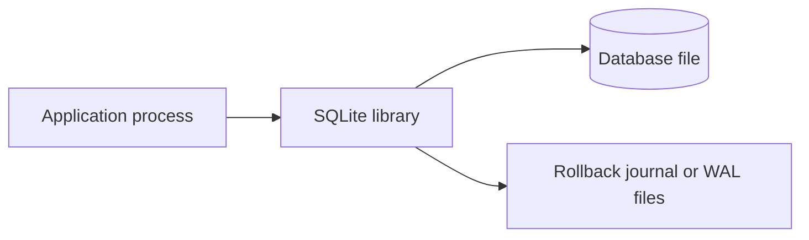

# SQLite: Embedded Relational Database

SQLite is a small, embedded relational database engine. It implements SQL, transactions, indexes, and constraints inside the application process, storing a database in a local file. It does not require a separate database server process or network connection.

That design makes SQLite common in phones and other devices: applications can keep structured data locally without provisioning a database server. Android includes SQLite as a platform capability, and many applications use SQLite or a SQLite-based data layer for local state. Browser storage, application libraries, and device vendors may choose different storage engines; SQLite is common, not universal.

## How SQLite works



The application links to or loads a SQLite library and calls it directly. SQL statements run in the application process; SQLite reads and writes the database file. In Write-Ahead Logging (WAL) mode, a `-wal` file holds changes not yet checkpointed into the main database, and a `-shm` file coordinates access between connections.

The absence of a server simplifies deployment, but it also means SQLite is usually best when the database file is local to the application host and the number of concurrent writers is modest.

## Why use it?

- **Embedded and portable:** No database daemon, account provisioning, or network round trip is needed for local operations.
- **Transactional:** Supports ACID transactions, indexes, constraints, and SQL queries.
- **Low operational overhead:** A database can often be shipped as an application file and backed up with application-aware tooling.
- **Useful offline:** Mobile and desktop applications can read and write local data while disconnected, then synchronize with a remote service if the product needs shared data.
- **Small footprint:** The library is suitable for environments where a separate database service would be excessive.

Common examples include local app settings and history, cached or downloaded content, drafts, device metadata, and test or development data. Do not store shared, authoritative business data only in one user's local database unless that is the intended product model.

## When not to use it

Choose a client-server database such as PostgreSQL when many remote clients need coordinated access, the workload has sustained concurrent writes, or database operations need centralized users, network access control, replication, and server-side observability.

SQLite can serve concurrent readers, but write transactions take locks and only one writer can make progress at a time per database file. WAL improves reader/writer coexistence; it does not turn SQLite into a multi-writer database. Long write transactions, high write contention, or multiple machines opening one shared database file can create contention or reliability problems.

Avoid treating a database on a network filesystem as equivalent to a local database server. Correct locking and durability depend on filesystem and platform behavior; SQLite deployments are generally simplest and safest with a local file.

## SQL, types, and constraints

SQLite supports tables, joins, indexes, views, triggers, and transactions. Its SQL dialect and features differ from other database engines, so test application queries against the SQLite version actually shipped.

SQLite uses dynamic typing: values have storage classes, and ordinary column declarations generally express type affinity rather than rigid enforcement. This differs from the strict type behavior many developers expect from PostgreSQL or SQL Server. `STRICT` tables, available since SQLite 3.37.0, provide stronger type enforcement for supported types.

```sql
CREATE TABLE notes (
    id INTEGER PRIMARY KEY,
    title TEXT NOT NULL,
    body TEXT NOT NULL,
    updated_at TEXT NOT NULL
) STRICT;

CREATE INDEX notes_updated_at_idx ON notes(updated_at);
```

`INTEGER PRIMARY KEY` aliases the rowid in an ordinary rowid table. This is a SQLite-specific behavior; `WITHOUT ROWID` tables use a different storage organization. Do not assume every integer primary key in every database has the same semantics.

Foreign-key constraints should be enabled on each database connection unless the application framework already does so:

```sql
PRAGMA foreign_keys = ON;
```

Enabling foreign keys is connection-specific. Verify the setting in connection initialization and test that invalid references are rejected.

## Transactions and concurrency

SQLite transactions group related changes so they commit or roll back together. Keep write transactions short: do network calls and expensive computation before opening the transaction, then perform the required database changes and commit promptly.

```sql
BEGIN;

UPDATE inventory
SET quantity = quantity - 1
WHERE product_id = ? AND quantity > 0;

-- Application checks that exactly one row changed before committing.
COMMIT;
```

Use bound parameters (`?` in this example) instead of building SQL with string concatenation. Check affected-row counts and roll back when a business condition fails.

In rollback-journal mode, readers and writers coordinate through database locks. WAL mode usually allows readers to continue reading an earlier snapshot while a writer appends changes to the WAL. SQLite still permits only one writer at a time. Long-running readers can prevent checkpoints from fully advancing, allowing the WAL file to grow.

```sql
PRAGMA journal_mode = WAL;
PRAGMA busy_timeout = 5000;
```

Choose journal and synchronous settings based on the required durability and supported filesystem behavior. WAL is not always appropriate, and `synchronous=NORMAL` has different power-loss durability properties from `FULL`. Do not weaken durability settings without understanding and accepting the failure trade-off.

## Security

SQLite is a storage engine, not an encryption or authorization system.

- **Prevent SQL injection:** Use prepared statements and bound parameters for all untrusted values. SQL identifiers such as table or column names cannot usually be supplied as ordinary bound values; map those choices through a strict allowlist.
- **Protect the database file:** Apply operating-system permissions and platform storage protections so only intended users or processes can read database files, backups, and journal/WAL sidecars.
- **Plan encryption explicitly:** The standard SQLite library does not encrypt database files by default. If encryption at rest is required, use an appropriate platform facility or a vetted SQLite-compatible encryption solution, and understand key storage, backups, and recovery.
- **Treat local data as untrusted:** A user or another process may modify a device-local database. Revalidate sensitive data on the server; do not trust local records for authorization, payment, or other security decisions.
- **Limit resource use:** Bound input sizes and query work where data may be attacker-controlled. Do not enable extension loading unless required and controlled.
- **Handle sensitive data carefully:** Minimize what is stored, define retention and deletion, and protect exported or backed-up copies as well as the main database.

## Migrations, backup, and recovery

Applications should version their schema and run explicit migrations as part of upgrades. Keep migrations transactional where supported, make them safe for the installed starting version, and test upgrades using representative old database files. Do not assume deleting and recreating a local database is acceptable; it may contain user-created or offline data.

For backups, use SQLite's Online Backup API or another SQLite-aware mechanism when the database may be active. A plain copy of only the main database file while writes are occurring may omit committed data in the WAL or produce an inconsistent backup. Preserve or correctly handle journal sidecars according to the backup procedure. Test restoration, not only backup creation.

Define what happens when disk space runs out, the database is corrupt, a migration fails, or the user reinstalls the app. Recovery behavior is part of the data design.

## SQLite compared with a server database

| Concern | SQLite | Client-server database |
| --- | --- | --- |
| Deployment | Library in application; database is usually a local file | Separate server or managed service |
| Access | In-process calls; no database network round trip | Clients connect over a network protocol |
| Transactions | ACID transactions for local database work | ACID transactions, with distributed concerns across services |
| Writers | One writer at a time per database file | Multiple concurrent writers managed by server |
| Best fit | Local, embedded, offline-capable, modest write concurrency | Shared multi-user service, remote access, higher concurrency |
| Operations | Simple deployment; application owns file lifecycle and backups | More server administration; centralized access, monitoring, and backup options |

SQLite is not a “toy database.” It is a mature relational engine with a different deployment and concurrency model. Select it when embedded simplicity is a strength; move to a server database when shared access, write concurrency, or operational requirements justify the added service.

## Interview Questions

### Q1: What does “serverless” mean for SQLite?
* Answer: SQLite does not require a separate database server process. The application calls the SQLite library directly, and the library reads and writes a database file. It does not mean “hosted in the cloud.”

### Q2: Can SQLite handle concurrent access?
* Answer: Yes. It supports concurrent readers and coordinates access with locks. WAL mode can let readers proceed alongside a writer, but only one writer can make progress at a time per database file.

### Q3: Does WAL mode make SQLite a multi-writer database?
* Answer: No. WAL improves reader/writer coexistence and write behavior, but it does not allow multiple simultaneous write transactions on one database file.

### Q4: Why might a mobile application use SQLite?
* Answer: It provides local structured storage with SQL and transactions, works without a network connection, and does not need a separate database service. The app must still handle synchronization, schema upgrades, privacy, and recovery when relevant.

### Q5: Why should applications enable SQLite foreign keys explicitly?
* Answer: Foreign-key enforcement is configured per connection and may be off by default. Applications should enable it during connection setup and test that invalid references fail.

### Q6: Is SQLite encrypted by default?
* Answer: No. The standard SQLite library does not encrypt the database file by default. Use platform protections or a vetted encryption solution when at-rest encryption is required.

### Q7: Is copying the `.db` file always a safe live backup?
* Answer: No. In WAL mode, recent committed changes may remain in the WAL file, and copying only the main file during writes can create an incomplete or inconsistent backup. Use SQLite's Online Backup API or a suitable SQLite-aware backup process and test restoration.

### Q8: When should a system move from SQLite to PostgreSQL or another server database?
* Answer: When multiple remote clients need shared coordinated access, write contention becomes material, or centralized operations, access control, replication, and server-side capabilities are required. Decide from measured workload and requirements, not from the assumption that SQLite cannot scale at all.
